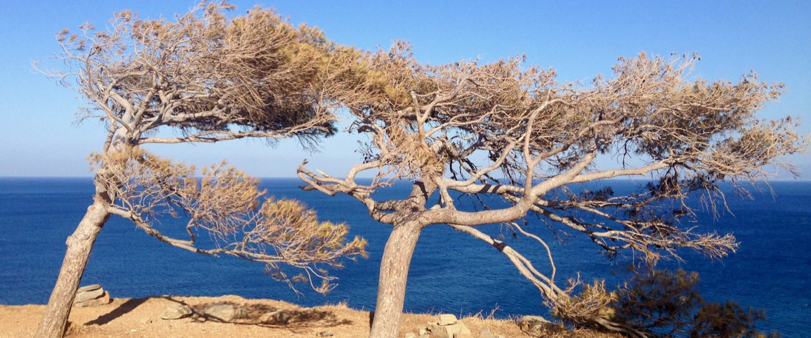

[22–23 March 2027 · Montpellier, France · Free of charge]{.meeting-dates}

{fig-alt="Two wind-shaped trees on a cliff above the sea"}

::: {.callout-note}
## Registration

The tutorial (22 March) and the colloquium (23 March) have separate registrations. See
[Registration](registration.qmd).

This site is in progress. The programme is tentative, and details on the venue will be added.
:::

## About

Ecological systems can respond to stress gradually, nonlinearly or through abrupt shifts between
states. Many methods now exist to detect such changes, to measure resilience and to anticipate
transitions, but it is often unclear which of them can be applied to the data that ecologists
actually have.

***ecoFAST2027*** is a tutorial and colloquium structured around the question of
whether resilience can be quantified and abrupt shifts
anticipated from empirical data, and what current methods can and cannot deliver.

Four questions frame the meeting:

1. **Detection.** How common are abrupt shifts in ecological time series, and why are they missed?
2. **Measurement.** Which resilience metrics can be estimated from data?
3. **Mechanism.** Can interactions and causality explain why a system shifts?
4. **Anticipation.** Do early-warning signals and machine learning work on real data?

## Programme

- **Monday 22 March:** [ecoFAST tutorial](tutorial.qmd), a practical course on the ecoFAST R
  package.
- **Tuesday 23 March:** [colloquium](colloquium.qmd) of invited talks, open to all.

## Invited speakers

- Miguel Berdugo, Complutense University of Madrid, Spain
- Alejandro Viloria Cano, MARBEC, Ifremer, France
- Stephan Munch, NOAA Southwest Fisheries Science Center and University of California Santa Cruz, USA
- Mathieu Pélissié, University of Padova, Italy
- Benoît Pichon, University of Stuttgart, Germany
- Francesco Pomati, Eawag, Swiss Federal Institute of Aquatic Science and Technology, Switzerland
- Juan Rocha, Stockholm Resilience Centre, Stockholm University, Sweden
- Serguei Saavedra, Massachusetts Institute of Technology, USA
- Martina Sánchez-Pinillos, National Museum of Natural Sciences (MNCN-CSIC), Madrid, Spain
- Camilla Sguotti, University of Padova, Italy

Further speakers will be announced.

## Contact

Vasilis Dakos, Institut des Sciences de l'Évolution de Montpellier (ISEM), CNRS, University of
Montpellier: [vasilis.dakos@umontpellier.fr](mailto:vasilis.dakos@umontpellier.fr)

## See also

- [Vasilis Dakos's website](https://www.vasilisdakos.info)
- [BioDICée team](https://biodicee.edu.umontpellier.fr/)
